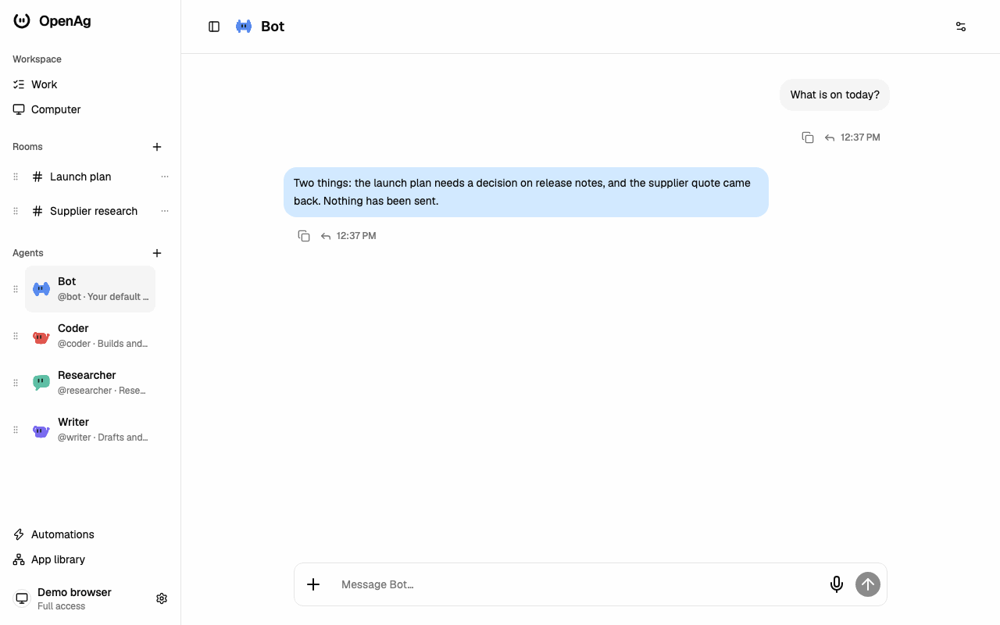
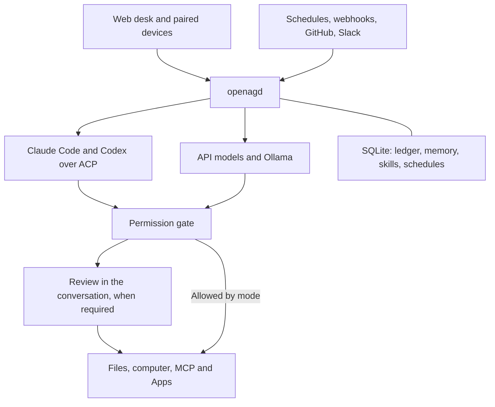

<div align="center">

<picture>
  <source media="(prefers-color-scheme: dark)" srcset="docs/assets/openag-logo-dark.svg">
  
</picture>

# OpenAg

**Your agents. One desk. Your server.**

An always-on home for AI agents that runs on your own Mac. Bring the Claude Code and Codex sign-ins you already have, add API or local Ollama models, and let them work together, remember what matters, and ask before they act.

[**What you can do**](#what-you-can-do) · [**Quick start**](#quick-start) · [**Models**](#models) · [**Safety**](#safety-model) · [**Docs**](#documentation)


</div>

<picture>
  <source media="(prefers-color-scheme: dark)" srcset="docs/notes/desk-shell/demo-dark.gif">
  
</picture>

*Demonstration data with scripted agent replies (`scripts/capture-demo.mjs`). [Desktop and phone screenshots](docs/notes/desk-shell/README.md).*

OpenAg is one daemon, `openagd`, plus a web desk. The daemon owns the database, memory, tools, schedules and every permission decision. Your browser and phone are just windows onto it. Keep it running on an always-on Mac and your agents keep working while you are away, then tell you only what is worth your attention.

> **v0.5, early release.** macOS is the supported platform (launchd service, Cua computer sandbox); Linux and Windows are untested. Expect rough edges. [ROADMAP.md](ROADMAP.md) lists what has shipped and what is open.

## What you can do

Things people use it for today:

- **"Every weekday at 8, go through my project notes and list what is still open."** A cron automation runs the prompt on a schedule. Proactive results go through a "worth waking" filter (deduplication, active hours, urgency, a daily budget); everything else lands in a **morning brief**.
- **"@coder fix the failing test, then @codex review it."** Put a Claude Code agent and a Codex agent in one room. Mention one, mention `@everyone`, or let the room lead delegate.
- **"Book the table on the restaurant's site."** Agents can drive a sandboxed computer (screenshots, clicks, typing). When it reaches a login or a payment step, take over the screen yourself and hand it back.
- **"When a new issue is opened on my repo, summarise it and ping me if it looks urgent."** Webhooks, GitHub polling and Slack can trigger agent runs. Triggered runs are isolated and have stricter tool rules.
- **"Remember that I prefer short answers."** Each agent has its own `MEMORY.md` and vector search. An optional nightly reflection saves useful notes, and repeatable workflows become versioned skills that you approve.
- **Approve from your phone.** When an action needs your review, it waits in its conversation. Pair your phone, get a push notification, then accept, edit, respond to or ignore it.
- **Use your existing tools.** Connect MCP servers, install Apps, or use the optional Composio bridge. Every tool call goes through the same permission gate.

<details>
<summary><b>Everything in v0.5</b></summary>

| Capability | What you get |
| --- | --- |
| **A team in one conversation** | Direct chats, shared rooms, a room lead, `@mentions`, `@everyone` and delegation between agents. |
| **Approvals in the conversation** | Three permission modes: Read Only and Workspace Write ask before risky actions; Full access runs without prompts. The daemon enforces the mode, not the agent. |
| **Memory** | Per-agent `MEMORY.md`, vector search (sqlite-vec), versioned skills, optional nightly reflection. |
| **A computer you can take over** | A shared computer backend with screenshots and input. Human takeover pauses agent input until you hand it back. Cua is the default; Browserbase, Docker and SSH are optional. |
| **Quiet proactive work** | Heartbeat, worth-waking filter, notification budget and a morning brief. Off until you turn them on. |
| **Scheduled and triggered work** | Cron automations, verified webhooks, GitHub polling, optional Slack. |
| **Tools and connectors** | MCP client and server, owner-installed Apps, optional Composio. |
| **Every device** | Responsive web desk, device pairing and revocation, push notifications (ntfy), Tailscale access, optional WebRTC. |
| **A record of the work** | Append-only event ledger, approval records and daily verified SQLite backups. |

</details>

## Quick start

**You need:** a Mac, [Node.js 22+](https://nodejs.org), [pnpm 10](https://pnpm.io/installation), and one model source: a [Claude Code](https://docs.anthropic.com/en/docs/claude-code) or [Codex](https://github.com/openai/codex) sign-in on this Mac, an API key, or [Ollama](https://ollama.com).

```sh
git clone https://github.com/k0nkupa/openag.git && cd openag
pnpm onboard
```

`pnpm onboard` checks Node and pnpm, installs and builds, detects your model sources without calling them (Claude Code, Codex, API key names, Ollama), optionally installs the always-on service, starts the daemon, and opens the desk signed in as the owner. It is safe to re-run and never overwrites your data or credentials. Use `pnpm onboard --dry-run` to see the plan first; `--yes`, `--service`, `--no-service`, `--lan`, `--skip-build` and `--ollama-model <name>` are listed under `--help`.

<details>
<summary><b>Manual steps</b></summary>

```sh
pnpm install && pnpm -r build
pnpm --filter daemon start        # serves the desk at http://127.0.0.1:4747
```

In a second terminal on the same Mac:

```sh
pnpm desk:open                    # signs this browser in as the owner
```

</details>

Say hi to **Bot**, your default agent. On first start OpenAg creates it on Claude Code, or on Codex if only Codex is installed, using your existing sign-in.

<details>
<summary><b>No Claude Code or Codex? Use Ollama or an API key</b></summary>

`pnpm onboard` offers the Ollama option itself (`--ollama-model <name>` to choose). To do it by hand, before starting the daemon, seed an agent on the model you have:

```sh
# Ollama (local, no key). The daemon reads http://127.0.0.1:11434 unless OPENAG_OLLAMA_URL is set.
ollama pull <model-name>
OPENAG_SEED_OLLAMA_MODEL='<model-name>' pnpm --filter daemon seed     # creates the agent "local"

# Or an OpenAI key: makes the sample lead "Boss" an API agent.
export OPENAI_API_KEY='sk-...'
export OPENAG_BOSS_MODEL='openai/gpt-4o-mini'
pnpm --filter daemon seed
```

Then start the daemon and run `pnpm desk:open` as above. The daemon reads keys from its own environment, so export them in the shell that starts it. Later, use **New bot** in the desk to add more agents on any provider whose key the daemon can see. Keep the Codex/Claude Code sample agents in the seeded `main` room only if you have those sign-ins.

</details>

### Keep it running and reach it from your phone

```sh
pnpm onboard --service          # or: scripts/install-service.sh (per-user launchd service with KeepAlive)
```

The daemon listens on `127.0.0.1` only. To use the desk from your phone:

- **Recommended:** [Tailscale](docs/tailscale.md). Run `tailscale serve --bg 4747` on the Mac and open the HTTPS address on your phone.
- **On a trusted home network:** install with `OPENAG_HOST=0.0.0.0 scripts/install-service.sh` and open `http://<mac-name>:4747`.

Then pair the phone from **Settings → Devices**. Re-run `pnpm desk:open` on the Mac any time you need to sign a browser back in. See [always-on operations](docs/ops.md) and [owner access and recovery](docs/notes/owner-access.md).

## Models

| Source | What you supply |
| --- | --- |
| **Claude Code** (over ACP) | An existing Claude Code sign-in on the Mac. |
| **Codex** (over ACP) | An existing Codex sign-in on the Mac. |
| **OpenAI, Anthropic, OpenRouter** (via Mastra) | `OPENAI_API_KEY`, `ANTHROPIC_API_KEY` or `OPENROUTER_API_KEY` in the daemon environment. |
| **Ollama** | A running Ollama server with a chat model. |

Pick each agent's model and reasoning level in its **Brain** settings. Keys stay in the daemon environment; they are never entered in the desk or stored in the database. Saving a setting makes no paid call.

**Subscription terms.** OpenAg runs the unmodified Claude Code and Codex CLIs under your own sign-in; it never handles your Claude or ChatGPT credentials. Providers meter automated and background use differently from interactive use: check [Anthropic's Claude Code terms](https://code.claude.com/docs/en/legal-and-compliance) and OpenAI's before relying on a subscription for unattended work, and prefer an API key for heavy scheduled use.

## Safety model

OpenAg is built for agents that can take real actions, so the daemon, not the model, decides what runs.

- **One gate for every tool call.** Every agent and runtime goes through the same permission check. Unknown tools need explicit review. The CLIs' own built-in tools are switched off, so they cannot bypass it.
- **You choose the mode.** Read Only, Workspace Write (the default) or Full access. Changing mode cancels pending reviews; it never replays past actions.
- **Background work is restricted.** Scheduled runs cannot use tools that would need approval unless you allow it per automation. Webhook and GitHub-triggered runs are isolated and, by default, have no tools.
- **Secrets stay out of the record.** Keys live only in the environment and are redacted from the database, logs and agent prompts. Devices hold revocable tokens stored as hashes.
- **Local by default.** The daemon listens on localhost. Nothing reaches the internet unless you configure it.

Optional pieces that do involve someone else's server, all off by default: Tailscale (device access), [Cloudflare Tunnel](docs/cloudflare-tunnel.md) (public webhooks only), ntfy (push), and a [sign-in relay](docs/signin-relay.md) you deploy to your own Cloudflare account for Composio/MCP browser sign-in without Tailscale. Read [SECURITY.md](SECURITY.md) for the threat model and known limits, and to report a vulnerability.

## How it fits together



## Documentation

| I want to… | Read |
| --- | --- |
| Understand every feature and setting | [Documentation index](docs/README.md) |
| Run it always-on, back it up, upgrade | [Operations](docs/ops.md) · [Backups](docs/backup.md) · [Local deployment](docs/local-deployment.md) |
| Reach it from my phone | [Tailscale](docs/tailscale.md) · [Devices](docs/notes/devices.md) |
| Let agents use a computer | [Computer use and takeover](docs/notes/cua.md) · [Browserbase](docs/notes/browserbase.md) |
| Connect tools | [MCP](docs/notes/mcp.md) · [Apps](docs/apps.md) · [Composio](docs/composio.md) · [Sign-in relay](docs/signin-relay.md) |
| Trigger agents from outside | [Webhooks](docs/notes/hooks.md) · [GitHub polling](docs/notes/github-poll.md) · [Slack](docs/notes/slack.md) · [Cloudflare Tunnel](docs/cloudflare-tunnel.md) |
| Tune proactive work and memory | [Reflection](docs/notes/reflection.md) · [Skills](docs/notes/skills.md) |
| Understand permissions | [Permission sessions](docs/notes/permission-sessions.md) · [SECURITY.md](SECURITY.md) |
| Contribute | [CONTRIBUTING.md](CONTRIBUTING.md) · [AGENTS.md](AGENTS.md) (architecture and safety rules) · [Roadmap](ROADMAP.md) · [Changelog](CHANGELOG.md) |

## Development

```sh
pnpm -r build && pnpm -r test     # build and test everything
pnpm --filter daemon dev          # build and run the daemon
pnpm --filter desk dev            # desk dev server, proxying the API to port 4747
```

See [CONTRIBUTING.md](CONTRIBUTING.md) for checks and conventions.

## License

[MIT](LICENSE). Vendored third-party skills are listed in [THIRD_PARTY_NOTICES.md](THIRD_PARTY_NOTICES.md).
