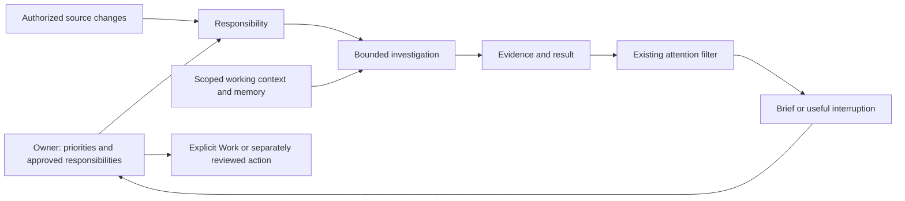

# Personal-secretary technical design

Owner-approved design, 2 November 2026, originally grounded in checkout `10310ff`. The owner confirmed the [product spec](../specs/personal-secretary.md) and the integrated event → investigation → evidence → result verification seam. The owner also clarified that this work shapes OpenAg's core product, not a single email rule. The owner subsequently approved the technical design and implementation sequence. Current status and implementation order are tracked in ROADMAP.md; the refreshed hosted-harness design records the implementation contracts. Deployment, live monitoring, account connection and external business actions remain outside this source authorization.

## Product direction and domain

OpenAg is the owner's personal secretary: it maintains an understanding of their day, carries agreed responsibilities forward and recommends useful next actions with evidence. Manuela's allocation questions are the first proof, not a hardcoded product feature.

The [glossary](../../GLOSSARY.md) distinguishes responsibility, investigation, source task, conversation turn, Work, memory, evidence and result. The [proposed ADR](../adr/0001-responsibilities-and-work.md) records why a standing responsibility is not a recurring Work item.

One responsibility can cause many investigations. An investigation can span bounded continuation turns. Several events can concern one issue, but a person/topic match alone does not establish that relationship. Source tasks remain in their original systems; discovering one does not import it as OpenAg Work.

## Original baseline patterns and gaps (`10310ff`)

The table below preserves the original design evidence at `10310ff`; its line references are not current-tree anchors. OA-342 subsequently removed implicit Work and added valid non-Work chat results. The refreshed [hosted harness design](hosted-harness.md) contains the current `c6aa061` seams for the next source slices.

| Area | Pattern to mirror | Limit this design must address |
| --- | --- | --- |
| Owner configuration | `apps/daemon/src/gateway.ts:698` owner-only memory update and audit | Responsibility configuration needs the same owner/device checks, revision guards and redaction. |
| Durable runs | `apps/daemon/src/automation-runs.ts:11` snapshot, links, settlement and restart recovery | Reuse the behavior; do not pretend automation runs are already investigation objects or store all configuration twice. |
| Polling | `apps/daemon/src/githubpoll.ts:171` fixed-host requests, cursor, delay/backoff | No verified daemon-owned Outlook/Teams/Asana read integration is established by this conversation. |
| Scheduling | `apps/daemon/src/automations.ts:587`, `apps/daemon/src/scheduler.ts:95` | Use the existing scheduler, overlap discipline and no-catch-up policy. No separate scheduler. |
| Runtime authority | `apps/daemon/src/runtimes/runner.ts:272`, `:404` | Frozen turn restrictions exist; source/account/resource restrictions and trusted principal context need explicit extension. |
| ACP built-ins | `apps/daemon/src/runtimes/acp.ts:90` | At the original baseline, isolation/offline checks depend on special room types. New investigation turns need proven native-tool restrictions, not just fewer offered MCP tools. |
| Tool registration | `apps/daemon/src/tools/firstparty.ts:24`, `apps/daemon/src/main.ts:99` | Register curated reads once and project consistently across runtimes. |
| Memory | `apps/daemon/src/vectors.ts:278`, `apps/daemon/src/runtimes/runner.ts:345` | At the original baseline, retrieval is bot-scoped. A responsibility must not inherit every same-bot room or external source implicitly. |
| Evidence/artifacts | `apps/daemon/src/results.ts:32` | At the original baseline, saved results require Work/tool-call provenance. OA-342 now permits gated chat results without Work; future daemon investigations still need genuine evidence/result origins. |
| Attention | `apps/daemon/src/wake.ts:183`, `apps/daemon/src/delivery.ts:17` | Keep one dedupe/quiet-hours/urgency/budget/destination decision. Investigation settlement and delivery are separate facts. |
| Brief | `apps/daemon/src/brief.ts:35` | Currently assembles digest and pending approvals; it is not an Outlook/Teams/Asana investigation. Feed it verified findings instead of adding provider reads to the brief renderer. |
| Public routes | `apps/daemon/src/static.ts:21` | Reserve any new responsibility route segment so static desk files cannot shadow it. |

This is source evidence, not deployment or account acceptance. The assistant's Outlook access during discussion does not demonstrate equivalent access in OpenAg. Existing Composio tools remain act-external and cannot silently become automatic reads because their descriptions sound read-only.

## Proposed module and interface

Add one **Responsibilities module**, keeping lifecycle, candidate deduplication, investigation settlement and delivery references together. Its small interface lets callers configure a responsibility, read its current state/history, check for developments and pause it. It owns revision checks, resource caps, scope snapshots and idempotent settlement. Avoid exposing a general workflow engine or a separate public operation for every internal transition.

Use existing **source connector adapters** at their real seam: bounded source reads. Existing Google reads and a future Outlook adapter have genuinely different transports; do not add a generic connector framework for a hypothetical provider. A curated adapter reports stable source/account identity, observed references, freshness and supported operations. Credential values never enter the model or responsibility record.

The existing **Runner module** remains responsible for model turns, tools, cancellation, policy and receipts. It receives an immutable, daemon-derived investigation scope. The model cannot choose an owner, replace an account, widen a resource set or fabricate an approval.

The existing **Wake module** remains the only attention decision. The existing desk is the result/review interface. New provider access and natural-language management are separate implementation slices; no second chat application or background agent loop is introduced.

## Responsibility lifecycle and owner controls

Recommended lifecycle: draft → enabled ↔ paused → retired. A proposal is a draft, never an enabled responsibility. An enabled responsibility can be blocked by unavailable access without losing its owner's configuration. Retired records/history remain inspectable; deleting history is a different operation.

Each version contains: purpose; responsible bot; owner-controlled destination; allowed source connection/resource references; topic/sender constraints where applicable; permitted read capabilities; cadence; per-run limits; attention preferences; enable/pause state; and stop conditions. Configuration and budgets are facts from the owner, not fields inferred from the triggering email.

Start with an owner-only gateway/desk form using the same configuration module. Proposed interface: list/read/save responsibilities, check a selected responsibility and pause it. Save/enable/pause use an expected revision; reject stale changes. Exact HTTP verbs/routes remain a slice-level interface decision, not a second management API copied into every tool.

Natural-language setup can later propose a reviewed responsibility through the same module, after OA-347's management authority design. It must show sources, purpose, limits and delivery before enabling. Relevance feedback may propose a revision; it cannot silently expand access or alter standing instructions.

## Source checks, investigations and recovery

Separate cheap change detection from model reasoning. Use the existing scheduler to run fixed, bounded daemon-owned source checks, analogous to the current GitHub poller. Recheck the current configured bot's effective read permission and the owner's source grant; an Ask/Denied read is blocked unattended, never silently promoted to Auto. These fixed connector operations are not model-chosen tool calls. Every model-chosen read still uses the existing authoritative tool gate.

Begin with one selected source/folder, an explicit start point, a conservative 30-minute cadence and bounded pages. These are proposed pilot defaults, not an urgency promise or a requirement to watch the whole mailbox. First enable establishes a baseline; it does not investigate historical mail. An explicit selected-message check is available for a separately authorized real pilot. Source outages, invalid cursors and bounded backlogs produce coverage gaps rather than reassuring silence.

Persist accepted candidate references before advancing a source cursor. The dedupe identity includes responsibility, source/account, item identity and material item revision; it does not include the changing configuration version. Configuration revisions are snapshotted separately so editing a responsibility does not replay old messages. Mark-read and other irrelevant metadata updates do not automatically constitute a new question. New events can be durably queued with a finite cap while one investigation runs.

Before investigation, recheck enabled state, account binding, source scope and current revision. Use strict sender identity where configured, then bounded topic relevance. Results are relevant, irrelevant or uncertain; do not dress an invented numeric confidence threshold as calibration. Evidence must support linking events to an issue; ambiguous correlation stays tentative. Source content cannot schedule another responsibility or widen a search destination.

An investigation records the question, originating event, trusted scope version, checked sources/times, bounded progress, result and outcome. Recommended outcomes: queued, running, completed, incomplete, blocked, interrupted and cancelled. Delivery state is separate: pending, ping, digest or suppressed. Complete means the bounded question was answered with its remaining uncertainty stated; it never certifies a financial transaction merely because tools returned.

Use daemon-owned atomic claims and uniqueness in SQLite; do not add distributed workers or leases while one daemon owns scheduling. On restart, mark unfinished attempts interrupted and preserve queued events. Reads may be scheduled as a new bounded continuation only after scope and completed evidence are rechecked. Do not replay an entire turn, fabricate completion or reinterpret an unknown action outcome. Persist result settlement and delivery intent together; identify published messages/digest entries by a unique investigation result version so a crash cannot emit the same notice twice.

Pause/revoke stops new checks and queued starts immediately, signals active reads, and rechecks scope before subsequent tool calls and publication. Cancellation does not prove a remote request stopped. Revoked or out-of-scope evidence is not delivered merely because it was fetched earlier. Resume does not catch up every missed occurrence automatically.

## Investigation authority and runtime parity

Introduce an immutable source-access profile derived from the approved responsibility: allowed curated tool names, bound connection/account, permitted folders/projects/resources and allowable search references. The server checks it at tool authorization and in the owning executor. Tool offering alone is not enforcement. Do not expose generic shell/computer/network tools in the first investigation profile.

Use unattended, noIndex investigation turns with no approval authority. Preserve isolated/noNetwork for existing hook, reflection and watcher runs. New investigation turns are a separately identified, owner-scoped route; an untrusted webhook or email cannot transform its current turn into that route. Delegation is initially disabled for automatic investigations until inherited source-scope enforcement is proven; the broader product may delegate through the same gate later.

API, Ollama and ACP must either enforce the same profile or report that automatic investigation is unsupported. ACP native tools require explicit disabling/authorization at the adapter seam, including tools that bypass MCP. Do not enable a subscription CLI merely because a controlled API runtime passed. Ordinary interactive chat retains its current approved tool path.

Internal progress writes and source cursors are daemon-owned bookkeeping. Canonical memory/skill changes remain approved actions. Suggested replies are local result text. Creating a draft in Outlook, sending mail, asking a colleague, allocating a transaction, posting accounting data or creating explicit Work remains a separate authorized operation.

## Persistence and result compatibility

Recommended additive records live in the daemon's existing SQLite database: responsibilities with revisions, source observation checkpoints, investigation attempts and bounded evidence/result references. Prefer one investigation record plus bounded structured evidence/result fields initially; normalize further only when a demonstrated query or size requirement warrants it. Do not duplicate provider mailbox content or create another task database.

Preserve exact observation provenance while keeping retained text redacted and capped. External cursor/delta tokens are secrets: keep them in the existing protected connector credential path, not plaintext ledger/settings/model context. Public references are daemon-issued handles; provider continuation links are never accepted as user-supplied fetch URLs.

Extend result provenance to support a turn/investigation without Work, through OA-342's existing compatibility work. Keep legacy Work-linked results and receipts. A result must have a real source origin; do not fabricate a tool-call identity when the daemon settles an investigation. Whether this is a new origin discriminator or additive nullable fields must be settled in that slice with migration/readback checks against current schema.

Emit redacted counts/status in the hidden system ledger and permitted public result references in the destination conversation. Keep private message bodies and transaction data out of release help, static product knowledge and shared fixtures. Clients continue to hold no independent database.

## Working context, memory and priorities

Build working context from explicit owner priorities, approved responsibility configuration, relevant Work/source tasks, unresolved results and scoped evidence. Preserve which items are explicit versus inferred, their source, observation time and conflicting interpretations. Initially derive this view rather than add another editable task board or an autonomous long-term world model.

Keep OpenAg's own notes, vectors, reflection and skills. Add evidence/scope references to retrieved chunks where needed, with a forward-compatible migration. Investigation retrieval must filter eligible rooms/accounts/resources before selecting its top results; a same-bot match is insufficient. Retain existing ordinary-conversation indexing policy until a separately reviewed change; no historical backfill occurs under this design.

An approved correction must reach both the prompt and retrieval. Track which old memory representation it supersedes; exclude superseded content from active recall rather than pretending an edit erased all historical conversation. Version skills separately. Do not let an external email or model-generated hypothesis silently become a standing fact or reusable method.

The first next-action recommendation uses explicit priorities, verified deadlines, blockers and impact supported by sources. Explain the ordering in plain language; do not invent a scoring formula or silently change external task priorities. If evidence conflicts, present the decision rather than claim to know the owner's intention.

Daily briefs consume current verified findings, coverage gaps, unresolved questions and pending approvals through the existing digest/delivery path. The deterministic brief renderer does not gain model reasoning or provider access. A separate bounded investigation can prepare a recommendation that the brief includes.

## First real source and provider constraints

Recommend an Outlook read-only facade for the first external pilot, because the owner's concrete example is Outlook. Use the existing protected connector credentials, fixed-host request/error patterns and shared first-party registration. No send, update, mark-read, draft or accounting operation belongs in this facade. Teams and Asana follow only with their own verified account/resource scopes and acceptance; assistant-side connector availability is not evidence of daemon readiness.

Microsoft Graph v1.0 documents folder-scoped incremental message changes and continuation tokens. This supports bounded polling without a model on every check. A token is tied to its original query; validate continuation origin/path and account binding, preserve it opaquely, and disable redirects. Invalid tokens require an explicit reported rebaseline, not an unbounded mailbox backfill. [Message delta documentation](https://learn.microsoft.com/en-us/graph/api/message-delta?view=graph-rest-1.0).

Metadata-only Mail.ReadBasic does not supply the body/attachment access needed for the full investigation. Recommend delegated read-only Mail.Read for an explicitly connected account, with tenant consent and the exact mailbox/folder limitations verified during that connector's design. The provider grant can be broader than the responsibility's internal scope; show that distinction. No application-wide permission, mailbox connection or consent is authorized here. [Permissions reference](https://learn.microsoft.com/en-us/graph/permissions-reference#mailread).

The [list-messages contract](https://learn.microsoft.com/en-us/graph/api/user-list-messages?view=graph-rest-1.0) supports selected fields and bounded pages; following its nextLink is different from guessing a skip offset. Investigation rechecks current records at the referenced source; a transaction question cannot be settled solely from email or a preview.

## Files likely to change during approved implementation

This is a scope map, not authorization to edit these files now. Migration numbers must be allocated against the current tree when each slice starts; never reserve them from this snapshot.

| File/module | Planned operation and reason |
| --- | --- |
| `apps/daemon/src/responsibilities.ts` | CREATE the deep lifecycle/check/investigation module once its first vertical slice is approved. |
| `apps/daemon/src/db/migrations/` | CREATE additive responsibility/investigation and approved provenance/outcome migrations. |
| `apps/daemon/src/runtimes/{types,runner,api,ollama,acp}.ts` | UPDATE typed outcomes, context, optional Work and immutable source-access profiles; preserve all interactive callers and recovery. |
| `apps/daemon/src/prompt.ts` | UPDATE shared role-aware bounded input; no duplicated per-runtime secretary prompt. |
| `apps/daemon/src/{work,results,automation-runs,vectors}.ts` | UPDATE only the approved lifecycle, non-Work provenance, outcome compatibility and scoped recall required by each slice. |
| `apps/daemon/src/tools/{registry,firstparty}.ts` and scoped MCP exposure | UPDATE shared curated read definitions and authoritative profile enforcement. |
| `apps/daemon/src/outlook-connectors.ts` | Proposed CREATE for the first verified read facade; settle transport/configuration details before this slice. |
| `apps/daemon/src/{gateway,main,static}.ts` | UPDATE owner configuration, construction and route reservation. |
| Existing desk automation/history/result and Needs you views | UPDATE source readiness, responsibility pause/history, result links and honest incomplete states. Use existing UI components. |
| `scripts/verify-secretary.mjs` | Proposed CREATE standalone integrated assertions with temporary data, controlled sources/runtime/clock; reuse existing fixtures. |
| Release help/manifest and feature notes | UPDATE implemented behavior and verify packaged default-bot delivery for each approved slice. |

## Vertical slices and dependencies

This table describes the broader product sequence. ROADMAP.md is authoritative for current status and the owner-selected harness order. The approved OA-355 design has local dependent implementation tickets OA-369 through OA-372; later responsibility/connector slices still require their focused designs and applicable connection authority. OA-347 management authority remains separate.

| Slice | Observable behavior and real blockers | Verification through the agreed seam |
| --- | --- | --- |
| A. Continuity and truthful runs | OA-355 shared context and explicit incomplete outcomes; OA-342 chat without implicit Work and valid non-Work results. | Two-turn reference, cap stops, tool evidence and ordinary chat/approval recovery across controlled runtimes. |
| B. One responsibility, one synthetic event | Owner configures/pauses a responsibility; a synthetic matching message is investigated and a source-linked unsent reply reaches the desk without Work creation. Requires A and a proven source-access profile. | Whole gateway/scheduler/runner/result/wake route; irrelevant sender/topic, duplicate event, denied tool and pause/restart cases. |
| C. Outlook read-only readiness | Configure a curated source facade with synthetic OAuth/Graph transports, then separately authorized real account acceptance. Requires B and verified Microsoft app/tenant prerequisites. | Account binding, missing/expired access, paging/cursor secrecy, rebaseline gap and no exposed writes. No real consent during source work. |
| D. Useful ongoing attention | Repeated changes to an issue, unanswered requests and brief/priority suggestions use the same responsibility/result module. | Answered-request suppression, new material change, quiet hours, gaps, backlog and one-delivery-after-restart. |
| E. Contextual discovery and corrected memory | Approved related-task/document reads, version-aware code/spec discrepancy, current working context and persistent correction. Requires each selected source and scoped recall. | Synthetic cross-source case, source conflict, wrong-version rejection, correction persistence and no private-context leakage. |
| F. Natural-language responsibility setup | Primary proposes a reviewed agreement through the same interface, without enabling it itself. Requires OA-347's management authority design. | Limited/full-device behavior, stale revision, unapproved proposal, source-scope review and exact enable/pause authority. |

Do not defer all result/phone usability until F: B must already produce a reviewable result on the existing desk. Later slices deepen a working vertical loop rather than build disconnected layers.

## Validation, review and acceptance limits

The primary seam was approved by the owner: controlled event → authorized investigation → evidence/result → owner attention. Use real temporary gateway/runner/policy/persistence and controlled source/model/clock adapters. Existing standalone automation, Work, action-receipt, connector and bot-knowledge fixtures are the prior art. Test observable behavior and final public state rather than private helper calls.

Plan applicable builds/typechecks, the new standalone secretary check, affected existing standalone checks and packaged bot-knowledge verification. Run capabilities verification when changing governed search/computer/notification behavior. Do not run unit/Jest/Vitest or scripts/hooks that invoke them. Commands listed in the hosted-harness design are future gates, not results of this documentation task.

After approved implementation, resolve local Standards/Spec findings and perform a separate built-in Codex review of the intended change, using `codex review --uncommitted` in an isolated intended scope or `codex review --base <approved-base>` for branch changes. Use the current ticket Log for review evidence; historical design planning did not itself establish source acceptance. Fix substantive findings, rerun affected checks and re-review. A blocked review is not a pass or merge permission. Do not include unrelated research drafts or another agent's changes in a review/commit accidentally.

Only a separately authorized live pilot can establish real model relevance, mailbox auth, provider acceptance, useful notifications and phone usability. Begin with one scoped example and record false matches, missed material developments, owner review/correction minutes, freshness, latency and known usage. Unknown subscription metering is not free usage. No numerical quality target is represented as owner-approved.

## Accepted direction and remaining checkpoints

Accepted approval scope: domain language, one responsibility/investigation module beside the existing runner, the source-access profile, preservation of the existing attention gate, and slice A followed by B with synthetic data. The proposed Outlook facade and later sources still need their detailed connector design and separate connection authority.

The important trade-off is adding a first-class investigation instead of treating every automatic check as Work. It preserves the product distinction the owner requested, with a larger runner/provenance migration. This is **Large** overall because it crosses runtime context, durable state, source permissions and user-visible outcomes; A/B are bounded but not cosmetic changes.

Remaining design checkpoints: SDK retry conformance; exact scoped-source enforcement for ACP investigation built-ins; genuine daemon-investigation result provenance beyond the non-Work chat support already accepted in OA-342; and actual Outlook/tenant prerequisites before connector implementation. They are stated blockers for their respective slices, not reasons to repeat the product interview. No new framework, external memory engine, deployment, live monitoring, owner-auth redesign or historical transcript backfill is included.
