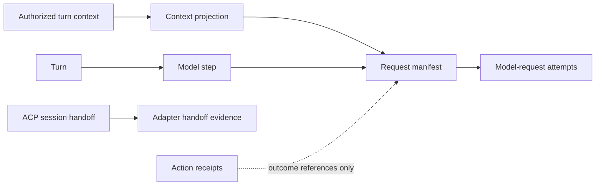

# Request provenance and context visibility

Status: accepted domain model, 4 November 2026. The owner selected this as the next DSH-inspired harness slice after permissions, requested domain modeling then a spec, and confirmed the end-to-end verification boundary. The implementation plan is now owner-approved; see `request-provenance.md` for source acceptance and deployment scope.

## Domain boundary

OpenAg should answer: “What information and tools did this agent receive for this decision?” The answer is a request manifest for one model step, qualified by the boundary OpenAg observed. It is not an exact replay, a full provider wire dump, proof of delivery, or proof that a tool effect occurred.

A turn contains model steps. A step has a context projection and one or more model-request attempts. Retrying a request does not create a new decision or authorize tool replay. Action receipts remain the authority for action outcomes. Request provenance explains inputs; it cannot clear Unknown, grant approval or change a permission session.

## Observation boundaries

| Runtime | Observable evidence | Remains unknown |
| --- | --- | --- |
| API providers, including DeepSeek | Daemon context selection; final SDK request inputs/settings for each step; attempt lifecycle; reported response model/usage when available | Provider-native serialization or hidden processing not observed at that seam |
| Ollama | Daemon projection and the actual chat payload assembled at the daemon-owned transport seam | Server-internal prompt construction, hidden context changes and unreported usage |
| Claude/Codex ACP | Daemon instructions, offered own-server tools/configuration and prompt/history delta supplied to the adapter; fresh/reused session identity | Child model requests, internal retained context/compaction, hidden native settings and provider token use |

Unknown coverage is explicit, never zero, complete or inferred from an adapter name. The same trace can contain several qualified observations without pretending they have equal fidelity.

## Sources and relationships

Source references identify authorized conversation messages, instructions, handbook, memories, assigned skills, recall, attachment references and retained tool results. They carry bounded selection/omission information and a version or redacted fingerprint when available. A mutable source that later changes cannot be reconstructed from its reference or fingerprint alone.

The request manifest keeps requested configuration separate from returned model evidence. It identifies the permission-session revision and independent turn restrictions supplied to the model; those references grant no authority. Offered tools are distinct from invoked tools. A schema fingerprint describes the offered contract, not proof that a tool ran.

## Scenarios that constrain the model

1. **Long chat:** an older authorized message falls outside the selected history window. The trace identifies the retained boundary and omission reason; it does not claim that the model forgot a message it received.
2. **Oversized required input:** current instructions/input/schemas exceed admission limits. Record a preparation refusal and no dispatch attempt. Do not silently summarize or drop required rules.
3. **Retry:** two attempts use the same step and projection. Attempt counts remain separate from steps. A changed payload must not be labelled an identical retry.
4. **Next tool step:** tools/results extend the model conversation. The next manifest reflects that actual request, not just the turn's initial prompt.
5. **Mutable skill:** the assigned skill changes after a request. The old manifest retains its observed version/fingerprint and labels content reconstruction unavailable.
6. **Reused ACP session:** a second prompt records a handoff delta and reused session. It cannot claim the child received a complete fresh context or that OpenAg observed its internal model request.
7. **Cancellation:** preparation can exist without dispatch. A started attempt is not proof of provider receipt; interruption does not trigger replay or resolve action uncertainty.
8. **Hidden or unauthorized history:** selection rules apply before provenance. A trace must not reveal source identities or counts from another agent's unauthorized conversation.
9. **Restart:** retained manifests and their qualifications survive. Older turns without them say Not recorded; no transcript-based reconstruction is presented as original evidence.
10. **Units:** selected text length, schema overhead and image count have distinct measurement bases. Provider token usage is labelled reported and may be unavailable.
11. **Diagnostics unavailable:** mandatory preparation evidence must settle before dispatch. If it cannot be persisted, refuse that request instead of silently running without provenance. A later recording failure is reported as an evidence gap, never a reason to rerun.

## Existing source ownership

- Runner and ledger history establish trusted turn/history boundaries and supporting sources.
- Prompt preparation selects history and clips context under current text budgets.
- API runtime's resolved model request and Ollama chat transport own the final daemon-visible request seam; retry policy owns attempt lifecycle.
- ACP runtime owns fresh/reused session handoff and permission-context replacement.
- Ledger/redactor own bounded durable evidence. Existing Work/turn activity and evidence components provide the owner inspection entry point.

Navigation: [runner](../../apps/daemon/src/runtimes/runner.ts), [prompt selection](../../apps/daemon/src/prompt.ts), [API](../../apps/daemon/src/runtimes/api.ts), [Ollama](../../apps/daemon/src/runtimes/ollama.ts), [retries](../../apps/daemon/src/runtimes/model-retries.ts), [ACP](../../apps/daemon/src/runtimes/acp.ts), [ledger](../../apps/daemon/src/ledger.ts), [redaction](../../apps/daemon/src/redact.ts).

## Verification boundary confirmed by the owner

One journey: desk chat → actual gateway/runner → daemon request or ACP handoff → durable manifest → owner inspection in the desk. Controlled provider transports establish the request/projection relationship; both real ACP adapters prove bounded handoff and second-call reuse. Fixtures cover retry, omission, cancellation, admission refusal, privacy and historical absence. This is the approved boundary for future implementation, not evidence that the feature exists.

See the [spec](../specs/request-provenance.md), [proposed decision](../adr/0005-request-provenance-without-replay.md) and pinned [DSH research](deepseek-harness.md). No runtime/help/tool capability changes are made by these design documents.
