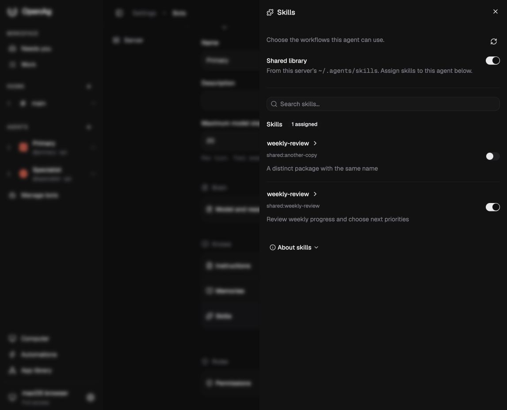
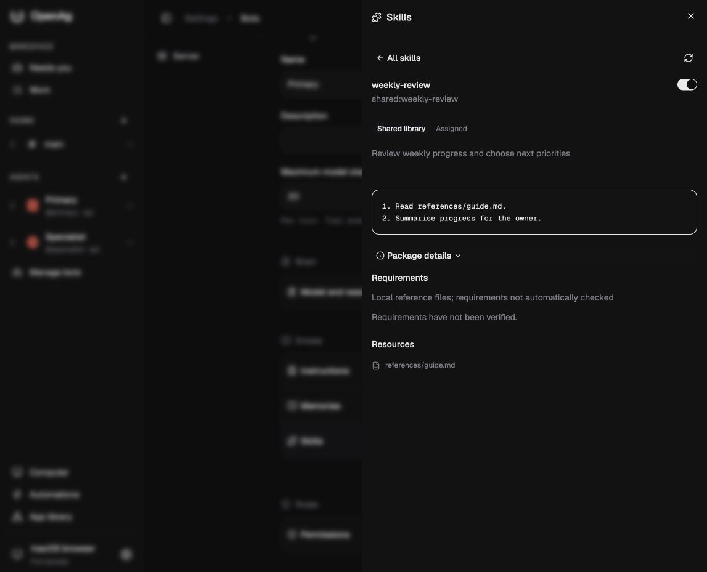
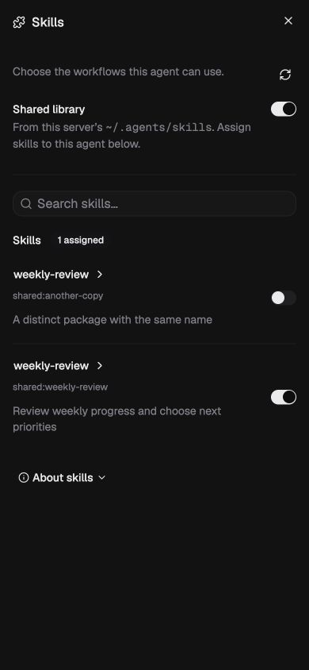
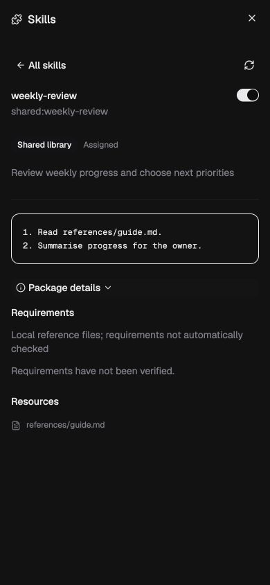

# Skills sheet redesign — OA-388 (originally OA-385)

Verified locally on 3 November 2026. This changes the desk presentation only; the daemon catalogue, assignment authority and action approval policy are unchanged.

The sheet reuses installed shadcn Base UI components. The global library switch stays separate from per-agent assignment switches. Search matches names, descriptions and qualified identities. Selecting a name opens a focused preview; assignment saves retain it. All skills returns focus to search. Package details and About skills disclose secondary information without repeating it in each row.

## Verification

- `pnpm --filter desk build` and `pnpm --filter daemon build`: pass. Desk reports its existing large-chunk advisory.
- `node scripts/verify-shared-skills-desk.mjs`: pass against the actual React panel, desk API and temporary gateway. Covers source enable/disable, preview, assignment readback and retention, search empty/recovery, back focus, agent isolation, Limited access, uncertain writes and failed readback locks.
- `node scripts/verify-shared-skills.mjs`: four integration groups pass; managed skills, tool approvals, source safety and assignments remain compatible.
- `node scripts/verify-bot-knowledge.mjs`: four delivery/policy groups pass. Updated `docs/help/memory-skills.md` is packaged; `docs/notes/skills.md` remains the authoritative feature explanation.
- Browser: actual built desk and temporary daemon with two distinct packages named weekly-review. Confirmed source identities distinguish them, search filters them, assignment keeps preview open, and package details expose references. Desktop and 390 × 844 layouts inspected; phone document width equals viewport width (390px). Screenshots below. Temporary source only; no real global library or installed daemon changed.
- `pnpm --filter desk exec tsc --noEmit`, script syntax and `git diff --check`: pass. Local review corrected the library assignment copy, preview heading semantics and requirements spacing. Built-in `codex review --uncommitted`: no actionable regressions.
- Unit/Jest/Vitest runners were not run, per owner instruction. Existing component expectations were updated statically.

## Screenshots

